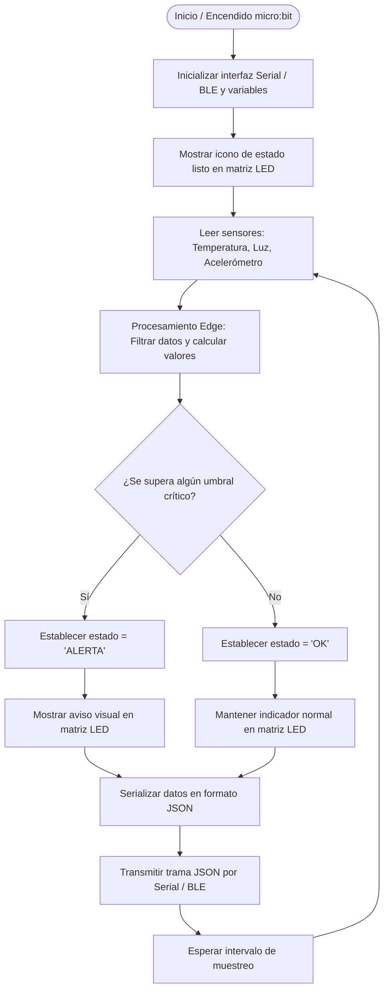

# Monitorización IoT con BBC micro:bit (Nodo Edge)

Este directorio contiene los recursos correspondientes a la práctica **UT2 - Tecnologías Habilitadoras Digitales (THD)** del proyecto `digitalizacion-daw2-monitor`. Incluye el firmware compilado para la placa BBC micro:bit (`main.hex`), los modelos 3D para su protección física (`carcasa_base.stl` y `carcasa_tapa.stl`) y la documentación técnica de funcionamiento.

---

## 1. Explicación del Algoritmo Edge

En esta arquitectura IoT, la placa **BBC micro:bit** opera como un nodo de **Edge Computing** (computación en el borde). En lugar de saturar la red enviando lecturas crudas e ininterrumpidas hacia la nube o el servidor central, el microcontrolador ejecuta localmente las siguientes fases de procesamiento:

1. **Adquisición de datos (Sensing):** 
   La placa realiza lecturas periódicas de sus sensores integrados (temperatura del procesador, nivel de luz ambiental mediante la matriz LED y aceleración en los ejes $X, Y, Z$).
2. **Filtrado y Preprocesamiento Local:**
   * **Reducción de ruido:** Se toman muestras en intervalos controlados para estabilizar las lecturas y evitar falsos positivos por picos puntuales.
   * **Evaluación de umbrales (Toma de decisiones en el borde):** El algoritmo compara los valores medidos frente a umbrales críticos predefinidos (por ejemplo, temperatura $> 30^\circ\text{C}$ o detección de movimiento/vibración brusca). Si se supera un límite, el nodo cambia su estado interno a modo alerta y ofrece retroalimentación visual inmediata en su matriz LED de $5 \times 5$.
3. **Serialización y Transmisión:**
   Una vez procesada y resumida la información, la micro:bit construye una trama ligera en formato **JSON** y la transmite hacia la pasarela (*Gateway* / PC) a través de la interfaz de comunicación configurada (Puerto Serie UART sobre USB / Bluetooth Low Energy).

---

## 2. Diagrama de Flujo

El siguiente diagrama representa el ciclo de ejecución del firmware desde el arranque del dispositivo hasta el bucle continuo de monitorización y envío:



---

## 3. Especificación de la Trama JSON

Para garantizar la interoperabilidad con el sistema receptor (script colector en Python, Node-RED o backend web), la placa emite cada paquete de datos como una cadena JSON en una sola línea terminada en salto de línea (`\n`).

### Ejemplo de trama emitida
```json
{
  "device_id": "microbit-daw2-01",
  "temp": 23,
  "light": 145,
  "accel": 1024,
  "status": "OK"
}
```

### Diccionario de datos

| Clave | Tipo de dato | Unidad / Valores | Descripción |
| :--- | :--- | :--- | :--- |
| `device_id` | `String` | Texto | Identificador único asignado al nodo sensor micro:bit. |
| `temp` | `Number` | Grados Celsius ($^\circ\text{C}$) | Temperatura ambiente estimada por el sensor térmico de la placa. |
| `light` | `Number` | $0 - 255$ | Nivel de luminosidad ambiental captado por los diodos de la matriz LED. |
| `accel` | `Number` | Miligravedades ($\text{mg}$) | Magnitud de fuerza/vibración detectada por el acelerómetro integrado. |
| `status` | `String` | `"OK"` \| `"ALERTA"` | Resultado de la evaluación lógica realizada en el *Edge* según los umbrales configurados. |

---

## 4. Estructura de Archivos de la Carpeta

* `main.hex`: Archivo binario compilado listo para flashear directamente en la memoria flash de la BBC micro:bit.
* `carcasa_base.stl`: Modelo 3D de la base inferior del encapsulado protector.
* `carcasa_tapa.stl`: Modelo 3D de la cubierta superior con acceso a botones y matriz LED.
* `README.md`: Documentación técnica del nodo Edge.